<p align="center">
  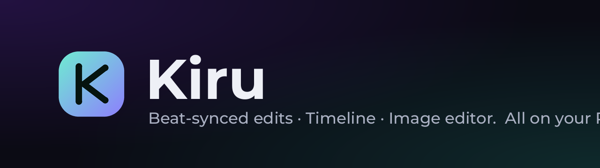
</p>

<h1 align="center">Kiru</h1>

<p align="center">
  <b>Beat-synced edits, a multi-track timeline and an image editor in one desktop app.</b><br>
  Everything runs on your PC. Nothing you load is ever uploaded.
</p>

<p align="center">
  
  
  
  
</p>

<p align="center">
  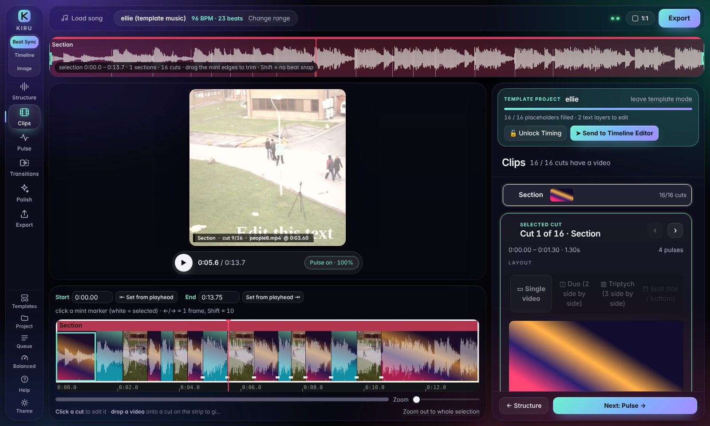
</p>

---

## Features

<table>
<tr>
<td width="50%" valign="top">

### 🧬 Template Engine
Drop in an edit you admire. Kiru reads it frame by frame and hands you its **skeleton**: every cut, how each transition blurs, flashes, zooms or whips, the beat thumps, speed ramps, slow push-ins, the colour look of each part, the on-screen text and its style, even cut-out characters on a backdrop. Motion is **measured with optical flow**, not guessed: a mirror smear and a title whose letters fly apart are recognised from how the pixels actually move. You get placeholders that say **Drop video here**. Fill them and the edit is yours.

</td>
<td width="50%" valign="top">

### 🥁 Beat Sync
Load a song and Kiru finds the tempo, the beat grid and the loud hits, then cuts your clips to them. Thumps, flashes, transitions and speed graphs land on the beat, and the preview is the same maths as the export.

</td>
</tr>
<tr>
<td width="50%" valign="top">

### 🎞️ Timeline
A CapCut-style editor: up to 8 video and 6 audio tracks, keyframes with easing for position / scale / rotation / opacity, Auto-Duck for music under speech, a searchable effects library you drag onto clips, ready-made motion presets, text styles, sound effects, linked audio, and **Clip Style** (outline, rounded corners, drop shadow) for face-cam boxes.

</td>
<td width="50%" valign="top">

### 🖼️ Image Editor
A Photopea-style editor: layers, blend modes, clipping masks, AI subject cut-out, a selection brush that snaps to edges, natural recolour, and Photoshop-like **Layer Styles**. **From a picture** turns the text of any poster, thumbnail or screenshot into editable layers with the closest font, and lets you swap logos.

</td>
</tr>
</table>

**You can always go back.** One **Undo / Redo** pair in the top bar (`Ctrl+Z` / `Ctrl+Shift+Z`) works in all three editors and covers everything: a clip dropped on a cut, a changed transition, a moved keyframe, a deleted track with all its clips, a brush stroke. **Save Project** (`Ctrl+S`) writes one small `.kiru` file with the Beat Sync edit, the Timeline and the picture you are working on; **Open Project** brings it all back, and a media file that has moved is outlined in red until you point Kiru to it.

**Made to fit you.** **Settings** (the gear at the bottom of the left bar) has three themes (**Dark**, **Light**, **OLED Black**), the performance profile for your PC (Automatic, High-end, Balanced, Low-end), the **language** (English, Svenska, Español, Français, Deutsch, 日本語, 한국어), and your **audio devices**. In the Timeline, **Record Voiceover** records your microphone while the edit plays and drops the take on an audio track. A preview-volume slider sits in the top bar, every colour box opens a quick palette first, and the tutorial is a small floating panel you can close for good.

## Screenshots

| Beat Sync | Timeline |
|---|---|
| 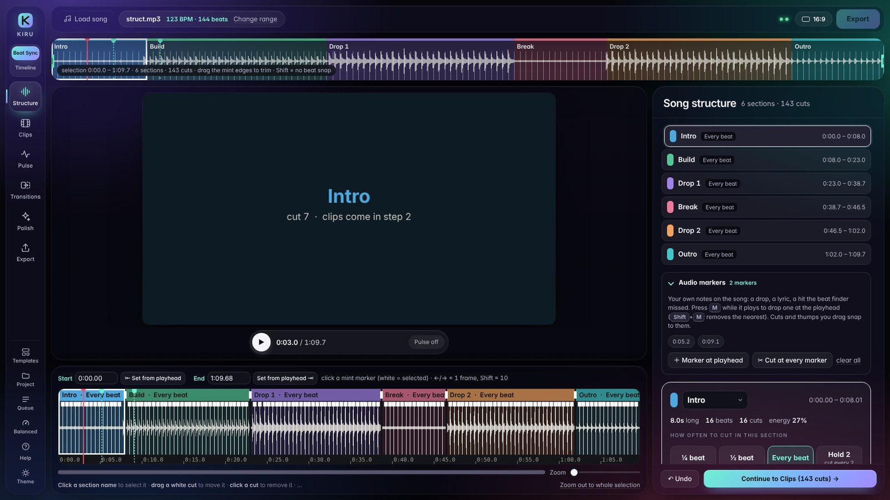 | 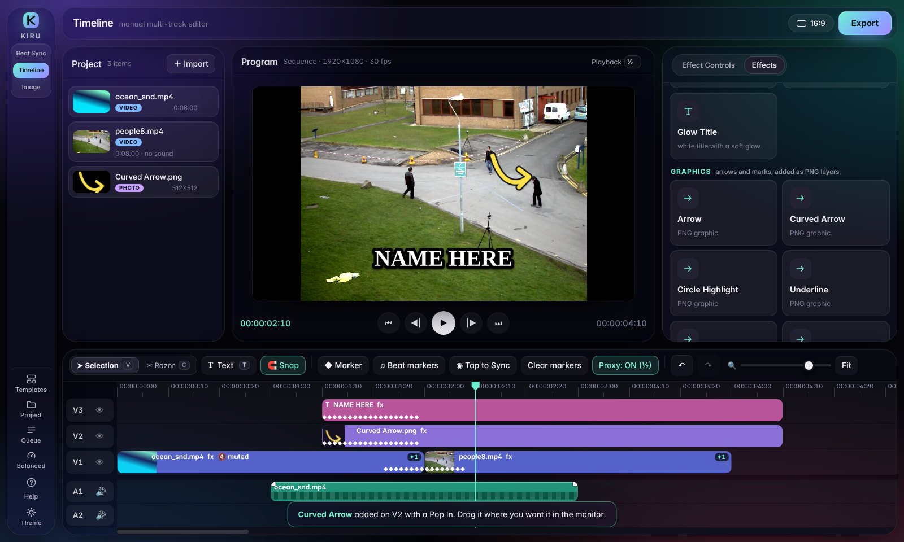 |
| 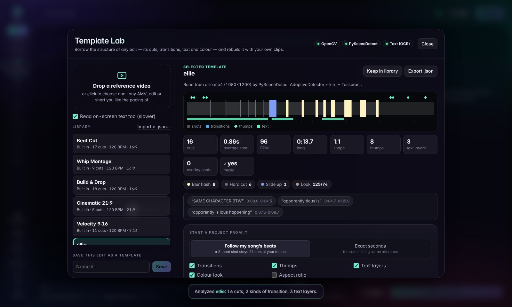 | 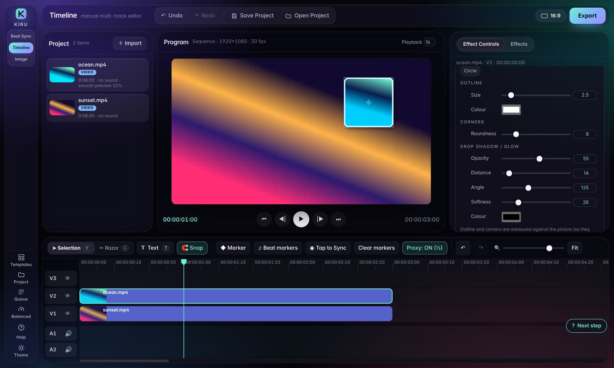 |

| Image Editor | From a picture |
|---|---|
| 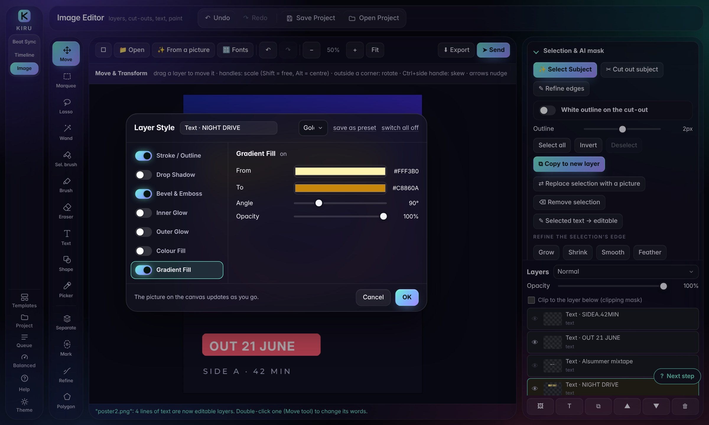 | 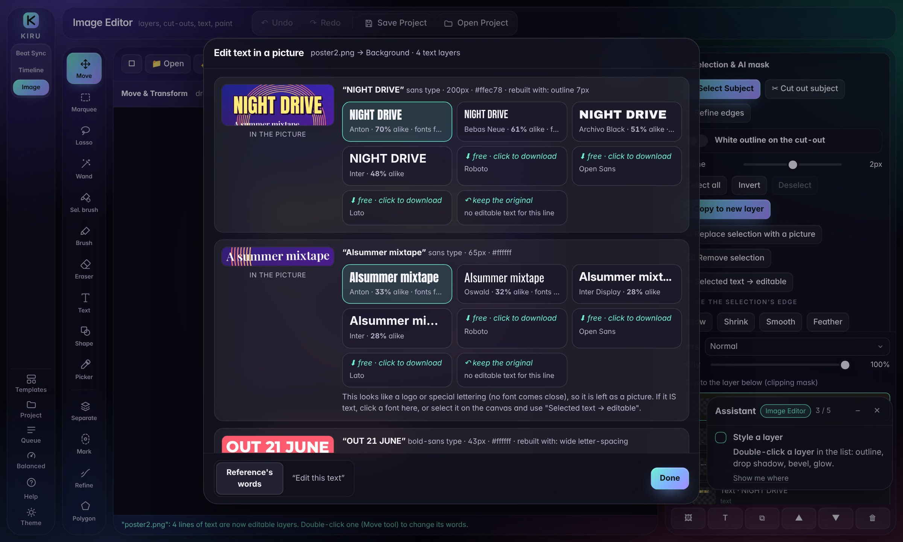 |
| 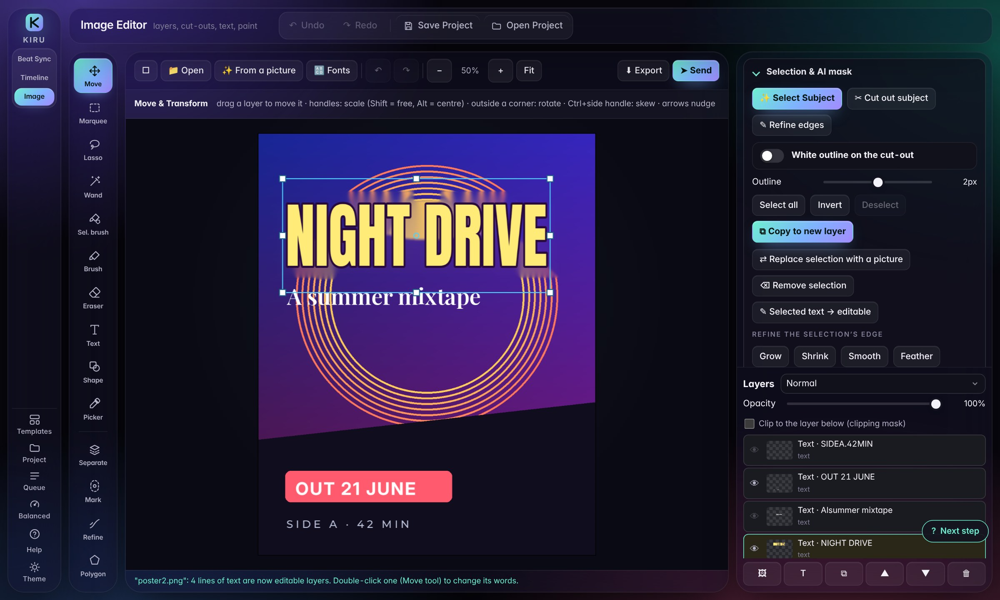 | 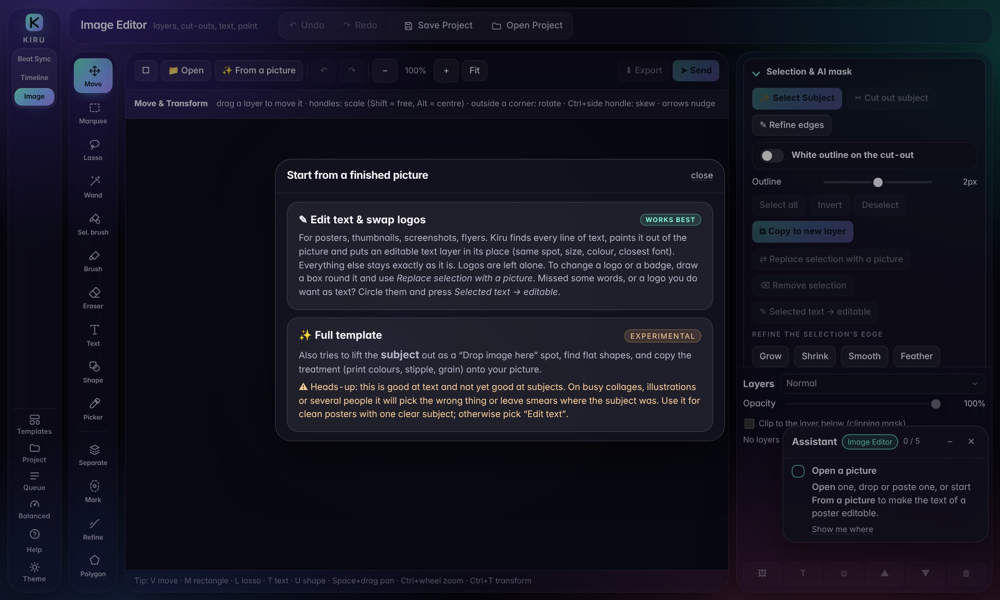 |

| The Assistant | Projects: a moved file is outlined in red |
|---|---|
| 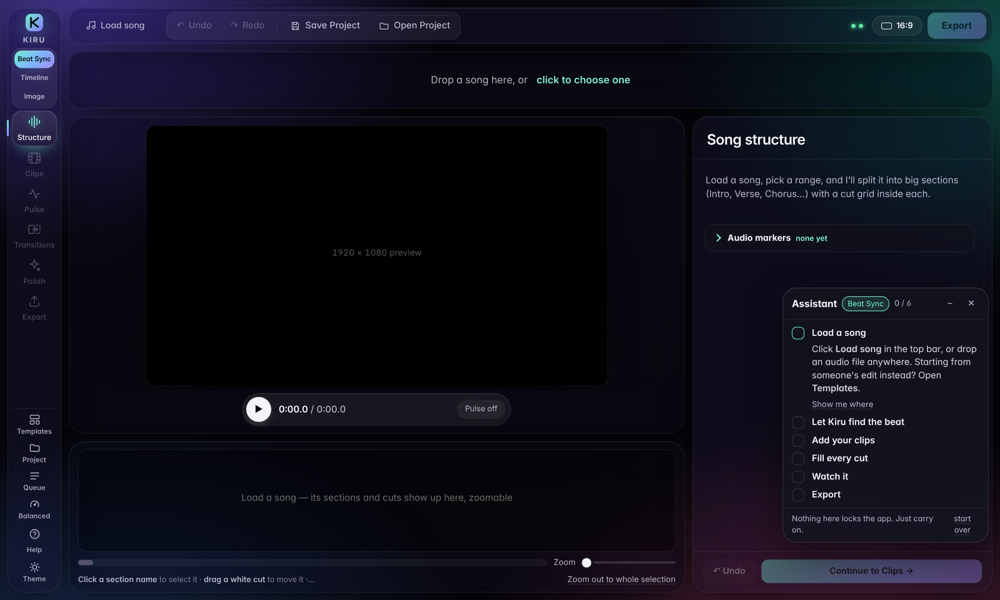 | 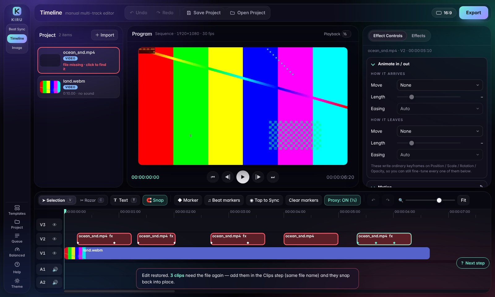 |

> Screenshots live in `docs/screenshots/`. Replace any file there with your own capture of the same name.

## Install

Kiru works **offline**. Editing, templates, the Assistant and exporting never need the internet. It is only used for things you click on: downloading a free font, or opening a site to post your video.

At first start Kiru looks at your processor, memory and graphics card and sets itself up for the PC (you can change it under **Speed**). Features the machine cannot run well are simply not shown: on a low-end PC AI background removal for video is hidden, and if the AI self-test fails it is hidden everywhere.

### Windows 10 / 11

1. Download **`KiruSetup.exe`** from the [Releases](../../releases) page.
2. Run it. It installs into `%LOCALAPPDATA%\Kiru`, for your user only: **no administrator password, no UAC prompt**. School and work laptops are fine.
3. Start **Kiru** from the Start menu or the desktop shortcut.

FFmpeg is bundled. Windows 10 needs the free [WebView2 Runtime](https://developer.microsoft.com/microsoft-edge/webview2/) (Windows 11 has it built in).
If SmartScreen says "Windows protected your PC" (the installer is not code-signed), click **More info > Run anyway**.

**Uninstalling** (Settings > Apps, or `unins000.exe`) removes everything: the whole `%LOCALAPPDATA%\Kiru` folder with its temp files, AI models, templates, fonts and settings. If the `Exports` folder still holds videos you made, you are asked first whether to keep them (they move to `Documents\Kiru Exports`).

### macOS 12 or newer

1. Download **`Kiru-x.y.z-macOS-arm64.dmg`** (Apple Silicon) or the `x86_64` one (Intel).
2. Open it and drag **Kiru** onto **Applications**.
3. The first time, **right-click Kiru > Open > Open** (the app is not notarised, so a double-click is refused once).

Your templates, fonts and exports live in `~/Library/Application Support/Kiru`. If the build has no FFmpeg inside, install it with `brew install ffmpeg`.

### Linux (x86_64)

```sh
tar -xzf Kiru-x.y.z-linux-x86_64.tar.gz
cd Kiru && ./install.sh          # installs into ~/.local, no root. Remove with ./install.sh --uninstall
```

Or download the **`.AppImage`**, make it executable (`chmod +x Kiru-*.AppImage`) and double-click it.

Start **Kiru** from the applications menu, or run `kiru`. Your files live in `~/.local/share/Kiru`. Needs FFmpeg (`sudo apt install ffmpeg`) if it is not bundled.

### From source (any system)

```sh
git clone https://github.com/<you>/kiru.git
cd kiru
pip install -r requirements.txt        # Linux: also  pip install "pywebview[qt]"
python kiru.py                         # its own window.  python app.py = in the browser
```

On Windows, **`Start_Tool.bat`** does all of that for you: it checks Python 3.10+ and FFmpeg, installs the packages, picks the right ONNX Runtime for your graphics card, and starts Kiru in its own window (the setup console closes by itself).

### Build the installers yourself

One script per system. Each installs what it needs, builds the app **without a console window**, and packages it.

| System | Run | You get |
|---|---|---|
| **Windows** | `build_windows.bat` | `dist\Kiru\Kiru.exe` and the installer **`dist\installer\KiruSetup.exe`** |
| **macOS** | `./build_mac.sh` | `dist/Kiru.app` and **`dist/installer/Kiru-1.0.0-macOS-<arch>.dmg`** |
| **Linux** | `./build_linux.sh` | **`dist/installer/Kiru-1.0.0-linux-<arch>.tar.gz`** (with `install.sh`) and, when `appimagetool` is installed, a double-clickable **`.AppImage`** |

**Windows.** Install [Python 3.10+](https://www.python.org/downloads/) and double-click `build_windows.bat`. That is all: it makes its own build environment, installs the packages, puts FFmpeg into `vendor\ffmpeg\` (it copies yours or downloads it), installs [Inno Setup](https://jrsoftware.org/isinfo.php) with `winget` if it is not there, and builds. If something it needs cannot be fetched, it says exactly what is missing and waits; it never fails silently.

**macOS.** Install Python 3.10+ and, to bundle FFmpeg, `brew install ffmpeg`. Run `./build_mac.sh`. The `.dmg` is for the machine's own architecture (Apple Silicon or Intel).

**Linux.** Install Python 3.10+ with `venv` and FFmpeg. Run `./build_linux.sh`. For the AppImage, put [appimagetool](https://github.com/AppImage/appimagetool/releases) on PATH first.

What the scripts do under the hood is `python scripts/build_installer.py`, which runs PyInstaller on **`kiru.spec`**:

- **`kiru.spec`** lists every module Kiru loads by name as an explicit hidden import (`webview.platforms.edgechromium`, `flask`, `librosa`, `onnxruntime`...), so the built app cannot start with one missing, and it bundles `vendor/ffmpeg` inside the app.
- One folder, `console=False` (the same as `--windowed` / `--noconsole`): no terminal ever opens. **UPX is not used**, to stay clear of antivirus false positives.
- Every FFmpeg and helper process Kiru starts is created with `CREATE_NO_WINDOW`, so nothing flashes on screen while it renders or makes proxies.
- On Windows the build **stops with a clear message** when FFmpeg is not there to bundle. If an `ai_model/` folder exists (Kiru fills it the first time you use an AI feature), the models are bundled too and the installed app needs no internet at all.
- Windows: `scripts/installer.iss` (Inno Setup, per-user, dark). macOS: `hdiutil`. Linux: `scripts/install_linux.sh` plus an AppDir for the AppImage.

PyInstaller cannot build for another system, so **`.github/workflows/build.yml` builds all three for you**: push a tag such as `v1.0.0` and `KiruSetup.exe`, the `.dmg`, the `.tar.gz` and the `.AppImage` are attached to the release. Nothing needs a screen.

## Tech stack

| Layer | What |
|---|---|
| Window | **PyWebView** (Edge WebView2): a native, frameless window with Kiru's own title bar and splash screen |
| Start-up | As simple as it gets: the engine (Flask) starts on a background thread and the window opens straight onto `http://127.0.0.1:5000`. No splash screen, no second process. The loading screen is part of the page: the first thing it draws is the logo in a spinning ring, with the editor hidden; it asks `/api/status` every 500 ms and shows the editor when the engine answers. The heavy background work (sound-analysis library, AI self-test) starts only after that, and nothing tests the graphics card while Kiru is starting |
| Engine | **Flask**, in the same process as the window. One Python interpreter, one copy of every library |
| Rendering | **FFmpeg** filter graphs, built so the export matches the live preview |
| Analysis | **OpenCV** (cuts, transitions, motion, text styles), **librosa** (tempo, beats), **PySceneDetect** |
| AI | **ONNX Runtime**: background removal (rembg) and the poster text reader (RapidOCR). Models load only when first used |
| UI | One self-contained page inside `app.py`. No CDN, no framework, no build step |

## How it works

There is no pop-up tutorial. A small **Assistant** sits in the corner and shows the next step for the mode you are in ("Drop a video on a cut to fill it"). It never blocks a click or a key; each step ticks itself when you have done it, and you can fold or close it.

### Templates from a reference edit

A template is the *skeleton* of an edit, stored as a small JSON file, plus the music it was cut to. It never contains anyone's video.

1. **Open Templates** (left bar). Pick a built-in one, or drop in a reference video you like.
2. **Analysis** runs on your PC and takes its time (about a minute for a 15-second edit). It reads the edit at 30 fps and works out:
   - every **cut**, with an adaptive content detector (cross-checked against PySceneDetect when installed);
   - then it **double-checks every cut**: it matches picture features before and after. If it is still the same shot (the editor only jolted, punched in or flashed the clip on the beat), that is not a cut: it becomes a **beat thump**;
   - the **transition** at each real cut (hard cut, dip, flash, **blur flash**, crossfade, wipe, slide / whip, zoom, spin), its length and its **easing**. Every transition is then measured frame by frame: how far it blurs, how white it goes, whether it zooms, spins or mirrors. Those numbers travel with the cut;
   - a **Mirror smear** is found with **dense optical flow** (OpenCV Farneback) on the frames of the transition and its landing: either the two sides of the frame stream opposite ways, or the whole picture streams sideways, fast, next to its own mirror image. A plain whip pan or a slide is not mistaken for one;
   - a title that leaves by **Letter Scatter** is measured the same way: letter-sized strokes in the text's colour are followed as they leave the text's box, and optical flow (camera motion taken out) has to show them flying every which way. When it starts and when the last letter is gone are measured too. A fade, a slide or a hard cut under the text does not count;
   - cuts **hidden inside long blurs** (a second, colour-layout based scene finder);
   - what each **shot** does on its own: a slow **push-in / pull-out**, a **zoom punch** on the cut, a **speed ramp** (fast-slow-fast);
   - **parts with their own look**: a dark graded first half and a bright, glowing second half become two looks, each with its own time range;
   - **cut-out scenes**: a person or object cut out on a flat backdrop, with a shadow. The backdrop colour and vignette are measured, and each cut-out becomes a **floating-layer spot** (see below);
   - **overlay clips** that pop in over the picture (best on calm footage; a busy, shaking background can hide them);
   - the **music**: tempo, beat grid, the loud hits, and the soundtrack itself, which travels with the template;
   - **on-screen text** with Tesseract (optional): where it sits, when, its colour, whether it glows or has an outline, how it arrives (pop, slide, type-on, fade), and the kind of font (tall condensed caps become Impact / Bebas Neue). Every line is read a second time from an enlarged close-up. Captions that keep re-appearing become one caption layer; small words that stay put for most of the edit are flagged as the **watermark**;
   - the **colour look** (with glow), and black bars that move.
3. **Pick what to copy.** The cuts always come along. Transitions, thumps, text, colour look, speed ramps and push-ins, cut-out scenes, the music and the aspect ratio each have a tick box, so you can take the pacing of an edit and do the rest yourself.
   > Cuts and transitions are measured and reliable. Thumps are the hardest thing to read from a finished video: check them in **Pulse**. Text is read well when it is clean block type; script fonts and tiny lyric lines come out wrong.
4. **Start project from template.** You get a fresh project made of placeholders:
   - the template's **music is already loaded** as the song, so you see the waveform and hear the beat you are cutting to;
   - each placeholder says **Drop video here (2.5s)** and keeps the reference's exact length, speed graph, transition and thumps;
   - each text layer starts with **the reference's own words** in the reference's style, so the edit looks right before you type anything. Click it and type yours;
   - cut-out scenes get their plain **backdrop** automatically, and a **Drop cut-out here** spot for each floating picture: drop any photo or video and Kiru cuts the subject out (first frame of a video), gives it the reference's shadow and puts it where the reference had it;
   - timing is **locked** until you click **Unlock Timing**. **Transitions and Pulse (the thumps) are never locked**: thumps are the hardest thing to read from a finished video, so nudge them freely.
   - **Letter Scatter** is a text animation for arriving and for leaving (the letters fly in from all over and settle, or the word breaks up and flies apart). A reference title gets it only when the analysis measured it; you can always change it under **Polish > Text**.
   - **Mirror smear** is in the transition list of every cut, and is set by itself on a cut where the analysis measured one.
5. **Drop your media** onto the placeholders (several files at once fill the next empty ones). Each clip is trimmed or speed-ramped to fit.
6. Want different music? **Load song**: the template snaps onto it, beat for beat when it knows its tempo, and your media stays put.
7. **Export**, or **Send to Timeline Editor** to refine it by hand. When the export is done, **Copy Video & Caption** puts the video *file* on the clipboard (with your caption as text): press `Ctrl+V` in Discord, a chat, or a site's upload field. The **Post** buttons open YouTube, TikTok, Instagram and X in your browser.

```json
{ "kiru_template": 1, "name": "Whip Montage", "aspect": "landscape", "bpm": 120,
  "cuts":   [ { "t": 0.0, "dur": 1.0, "beat": 0, "beats": 2,
                "transition": { "type": "left", "frames": 8, "ease": "snappy", "flash": false } } ],
  "pulses": [ { "t": 0.5, "kind": "zoom", "strength": 100 } ],
  "text":   [ { "text": "TITLE", "t0": 0.2, "t1": 2.0, "x": 0.5, "y": 0.8, "anim": { "in": "slideup" } } ],
  "look":   { "contrast": 112, "sat": 120, "temp": 8 } }
```

**Save** writes the template to `templates/` as a `.json`, with its music next to it as `.m4a`; **Save this edit as a template** does the same for your own structure; **Export .json** / **Import** share it.

### The Timeline

1. Click **Timeline** at the top of the left bar.
2. **Import** media into the Project bin (or drop files straight onto a track). Heavy formats such as MKV, HEVC or ProRes get a light preview copy automatically; the export always reads the originals.
3. **Arrange**: drag clips to move them, drag edges to trim, `C` for the razor, `Ctrl+K` to cut at the playhead, `S` for snapping.
4. **Animate**: select a clip and use **Effect Controls**. Click the stopwatch next to Position, Scale, Rotation or Opacity to add keyframes at the playhead. Set blend mode, crop, colour, speed or a speed graph.
5. **Effects and motion**: open the **Effects** tab. Drag anything onto a clip, or double-click to apply it to the selected clip. Effects get sliders in Effect Controls; motion presets and transitions become keyframes you can edit.
   - a **transition** dropped on a clip shapes the cut at its start (the clip before it and this one);
   - **Graphics** and **Text Styles** add a new animated layer at the playhead; your own PNG works the same way: import it, then pick its move in **Animate in / out**;
   - **Sound FX** land on A1 / A2.
   - **Right-click** a clip, or the picture in the monitor, for Fit / Fill / Stretch, flips, speed, Detach Audio and **Link / Unlink** (a linked video clip and its audio move together).
   - **Keyframe easing:** put the playhead on a keyframe and **right-click its diamond** in Effect Controls: Linear, **Ease In**, **Ease Out**, **Ease In-Out**. The move follows a curve instead of a straight line, in the preview and in the export.
   - **Auto-Duck:** right-click an audio track header (A1, A2...) > **Auto-Duck to Video Audio**. While a video clip has sound, that track drops by about 15 dB and comes back up when the video is quiet.
   - **Clip Style** (Effect Controls): outline, rounded corners and a drop shadow or glow on any clip, with one-click presets (Webcam frame, Soft shadow, Glow, Sticker, Circle). It follows the crop, and the shadow follows a cut-out person when Background Removal is on.
   - **Right-click a track header** (V1, A1...) for **Add Video Track Above / Below**, **Add Audio Track** and **Delete Track** (up to 8 video and 6 audio tracks).
6. **Text**: `T` adds a text layer with the same animations as Beat Sync.
7. **Export** with the same engine as Beat Sync: presets, formats, sizes, the queue, and an optional In / Out range (`I` / `O`).

### The Image Editor

1. Click **Image** at the top of the left bar. **Open image** (or drop / paste one), or **New** for a blank canvas.
2. **Tools** (left): Move `V`, Marquee `M`, Lasso `L`, Magic Wand `W`, Brush `B`, Eraser `E`, Text `T`, Shape `U`, Eyedropper `I`, plus Mark Object `O`, Refine Edge `R`, Polygon `P`, Hand `H`.
3. **Cut-outs**: **Select Subject** finds the person with AI on your PC (a sharper model for stills, with the edge snapped to the picture's real edges). If it misses a bit, pick **Refine Edge** and scribble green over what to keep and red over what to drop.
   - **Separate Layer** `G`: draw a rough line *inside* a shape (a paper scrap, a letter tile, a sticker). The whole shape snaps onto its own layer with a transparent background and is painted out of the picture below (hold `Alt` to leave the picture as it is). This is how you take a collage apart by hand.
   - **Selection Brush** `A`: paint roughly over a thing and the selection grows to its edges and stops there (`Alt` takes away). **Grow / Shrink / Smooth / Feather** tidy the edge.
   - **Copy to new layer** (`Ctrl+J`) lifts the selection onto its own layer.
   - **Recolour** (Area effects): pick a new colour for the selected area. Only hue and colourfulness change; every pixel keeps its own lightness, so shadows, highlights and skin texture stay. Green skin for a meme still looks like skin.
4. **Layers** (right): blend mode, opacity, **Clip to the layer below**, drag to reorder.
5. **Text**: font, size, colour, outline, drop shadow, glow, and **Curve / arc**.
6. `Ctrl+T` shows the transform handles: drag to scale, outside a corner to rotate, `Ctrl` + a side handle to skew.
7. **Export PNG**, or **Send to the clip bin** to use it in an edit.

#### Layer Styles

**Double-click a layer** in the Layers list. A window opens (drag it by its top bar) with five effects, each with its own switch:

| Tab | Controls |
|---|---|
| **Stroke / Outline** | size, position (outside / inside), colour, opacity |
| **Drop Shadow** | distance, angle, spread, size, colour, opacity |
| **Bevel & Emboss** | depth, size, highlight colour, shadow colour |
| **Inner Glow** | size, colour, opacity |
| **Outer Glow** | size, colour, opacity |

The canvas updates while you drag. Styles work on any layer (picture, cut-out, text, shape), stay editable, show an **fx** badge in the list, and are part of Export and undo.

#### From a picture

**From a picture** (top bar) offers two ways to start from a finished poster, thumbnail, flyer or screenshot.

**Edit text & swap logos** (works best). Kiru finds every line of text, paints it out of the picture and puts an editable text layer in its place: same spot, size, colour and slant, with its **outline, drop shadow or glow** rebuilt and wide letter-spacing kept. Everything else stays one untouched picture.

- **Fonts as pictures.** For each line the report shows the original next to your words drawn in the closest fonts on your PC, each with a "% alike" score. Free Google Fonts of the same look are offered too: one click downloads the font into `fonts/` and uses it. **Get the free font pack** fetches 14 fonts covering every look and matches the poster again.
- **Logos stay logos.** Big lettering that no font comes close to (a brand logo, hand lettering) is kept as a picture by default. Click a font if you want it as text anyway, or **keep the original** to switch back.
- **You decide what is text.** Circle any lettering (Lasso or Marquee) and press **Selected text → editable**; it becomes a text layer even if Kiru had left it as a logo.
- **Every rebuilt line is an ordinary text layer**: letter spacing, weight and colour in Text properties; double-click the layer for outline, shadow, **gradient fill** and your own saved **style presets**.
- **Swap a logo or badge:** draw a box round it, then **Replace selection with a picture**. **Remove selection** just paints it out.
- Other scripts and upright columns of text stay in the picture.

**Full template** (experimental). Also tries to lift the **subject** out as a "Drop image here" spot, find flat shapes, and copy the reference's treatment (print colours, stipple, grain) onto the picture you drop in. Silhouette posters fill the shape with your picture instead.

> ⚠️ The full template is good at text and not yet good at subjects. On collages, illustrations or pictures with several people it picks the wrong thing or leaves smears where the subject was. Use it for clean posters with one clear subject; for everything else use **Edit text & swap logos**.

## Keyboard

| Key | Action |
|---|---|
| `Space` / `K` | Play / pause |
| `,` `.` | One frame back / forward (`Shift` = 10) |
| `J` `L` | One second back / forward (`Shift` = 5) |
| `Home` `End` | Start / end of the edit |
| `M` / `Shift+M` | Add / remove an audio marker |
| `←` `→` | Previous / next cut |
| `Ctrl+Z` / `Ctrl+Shift+Z` (or `Ctrl+Y`) | Undo / redo, in every editor |
| `Ctrl+S` / `Ctrl+O` | Save Project / Open Project (a `.kiru` file) |
| `Ctrl+scroll` | Zoom the timeline strip |
| **Timeline:** `V` / `C` / `S` | Selection tool / Razor / snapping |
| `Ctrl+K` | Cut at the playhead |
| `I` / `O` / `X` | Mark In / mark Out / clear |
| `T` | Add a text layer |
| `Delete` | Remove the selected clip |
| **Timeline:** right-click | Clip menu (Fit / Fill / Stretch, flips, speed, Detach Audio, Link / Unlink); on a track header: add / delete tracks |
| **Image:** `V` `M` `L` `W` `A` `B` `E` `T` `U` `I` | Move, Marquee, Lasso, Magic Wand, Selection Brush, Brush, Eraser, Text, Shape, Eyedropper |
| **Image:** double-click a layer | Layer Style |
| **Image:** `Ctrl+T` / `Ctrl+D` / `Ctrl+J` / `Ctrl+E` | Free transform / deselect / copy the selection to a new layer / export PNG |
| **Image:** `[` `]` | Brush / eraser size |
| **Timeline:** Record Voiceover (button) | Records the microphone chosen in Settings; the take lands on an audio track at the playhead |
| `F1` | Help for the current step |

## Languages

Kiru's words live in plain JSON files in the **`locales`** folder, one per language:

```json
{ "name": "Svenska",
  "strings":  { "Save Project": "Spara projekt", "Clear Timeline": "Rensa tidslinjen" },
  "patterns": { "Cut {0}": "Klipp {0}", "Delete Track {t}": "Ta bort spår {t}" } }
```

- Pick the language in **Settings > Language**. The page changes at once, tooltips included.
- **Anything a file does not have stays in English**, so a file can be partial. The six that ship cover the buttons, menus, panels, tools and the main tooltips (about 550 phrases each); long help texts and hints are still English.
- To add a language, copy `sv.json`, rename it (`it.json`), change `"name"`, translate the right-hand sides and restart Kiru. To fix a wording, edit the file.
- The translations are machine-assisted and have not been reviewed by native speakers yet: corrections are very welcome.

## Privacy

- The server binds to `127.0.0.1` only. It is not reachable from your network.
- No CDN, script or analytics request is ever made. The whole UI lives inside `app.py`.
- **The microphone** is only opened while you record a voiceover (or test the level in Settings). The recording stays on this PC like every other file.
- **One exception, only when you click it:** downloading a free font (or the font pack) in the Image Editor asks Google Fonts for it by name. Nothing about your project is sent.
- Working files go to `_temp/`, which is wiped on every start and on exit. Unsaved exports are deleted after 2 hours.
- The only other downloads are the one-time Python packages and the background-removal models.
- **AI self-test.** At every start Kiru tests the background-removal AI in a separate process. GPU fine: nothing to see. GPU fails: it switches to the CPU by itself and shows a small "AI running on CPU" tag. Fails completely: Background Removal is hidden, and Kiru never nags about it.

## Project layout

```
kiru.py               desktop launcher: starts the engine on a background thread, opens the window
app.py                the engine: Flask server, FFmpeg renderer, analysers, and the whole UI
Start_Tool.bat        Windows launcher for running from source
requirements.txt      Python packages
build_windows.bat     build Kiru.exe + KiruSetup.exe (fully automatic)
kiru.spec             PyInstaller description: hidden imports, bundled FFmpeg, no console
build_mac.sh          build Kiru.app + the .dmg
build_linux.sh        build the .tar.gz (+ .AppImage)
scripts/
  build_installer.py  what the three scripts run (PyInstaller, no console, no UPX)
  installer.iss       the Windows installer (per-user, dark, no admin rights)
  install_linux.sh    the Linux installer (per-user, no root)
  version_info.txt    Windows version metadata for Kiru.exe
.github/workflows/    builds all three installers on a tag
assets/               logo, icon, banner, installer art
docs/screenshots/     pictures for this README
locales/              one JSON file per language (Settings > Language)
settings.json         your settings (theme, language, devices): written by Kiru
templates/            templates you save (JSON + the music)
fonts/                fonts for the Image Editor (downloaded on a click, or your own)
Exports/              finished videos from the export queue
_temp/                working files (emptied on every start and on close)
```

## Contributing

Issues and pull requests are welcome. Keep the UI in `app.py` self-contained (no CDN, no build step) and make sure a preview change has a matching change in the renderer.

## Acknowledgements

Built by Aden. Thanks to the projects Kiru stands on: FFmpeg, Flask, PyWebView, OpenCV, librosa, ONNX Runtime, rembg, RapidOCR, PySceneDetect and Tesseract.

## Why Kiru is Free & Open Source

I used Claude as a tool to help me build this application. I am not pro-AI or anti-AI; I am pro-consumer. I want companies to own nothing and for users to own everything. You shouldn't have to rent your creativity or be gatekept from the tools you need to create. This project is open-source because the power belongs in the hands of the creators.

<sub><i>Disclaimer: This project was built with the assistance of Claude (Anthropic) as a coding tool.</i></sub>

### A note on forking

Kiru is free and open source, and it is meant to be built on: fork it, change it, make it yours. If you do, please keep the original copyright notice (`© 2026 Aden`) in the code, keep the Kiru name on what is still Kiru, and leave the attribution in place. I made this for the community, not for someone to put their own name on and sell back to you.

## License

MIT. See [LICENSE](LICENSE).

© 2026 Aden. All rights reserved.
